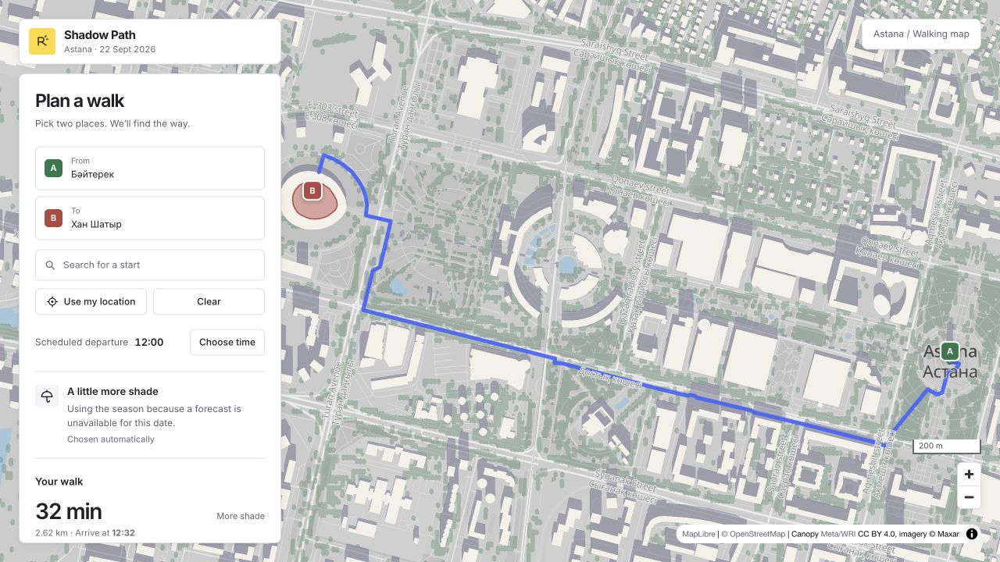
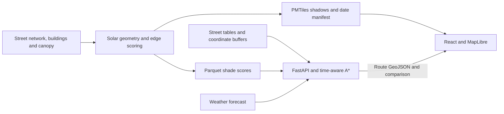

# Shadow Path

Pedestrian routing for **Astana, Kazakhstan**, that adapts to sun, shade, the season, and the weather.

**[Live demo](https://shadow-path-web.onrender.com)**

The shortest walk is not always the most comfortable one. Shadow Path combines a street network, building and tree geometry, solar position, and weather forecasts to suggest a route. It compares that suggestion with the shortest path, showing how much extra walking buys a change in sun exposure.



*Example from the cached 22 September 2026 dataset: a midday walk from Baiterek to Khan Shatyr gains 23 percentage points of modelled shade for about 3 extra minutes.*

## Features

- **Automatic route preference:** winter favours sun, summer favours shade, and spring or autumn adapts to the forecast. The interface explains the choice and identifies seasonal fallbacks.
- **Route comparison:** walking time, distance, arrival time, and sun or shade exposure alongside the shortest path.
- **Optional departure planning:** the planner starts with Astana's current time. `Choose time` opens scheduling and a comparison of departures across the day.
- **Interactive map:** building and tree shadows, place search with Cyrillic and Latin aliases, map selection, and device location.
- **Responsive interface:** a light map workspace on desktop and a compact planning sheet on mobile.

## Architecture

Expensive geometry runs in a separate data pipeline. A route request uses precomputed street scores and searches the walking network.



The tile exporter writes map shadows and routing scores from the **same shadow field**. The frontend takes its data date and supported times from the tile manifest, so the map and router refer to the same modelled day.

## Engineering decisions

### Account for the sun moving during a walk

A long walk can start in one shadow pattern and finish in another. The custom A* search tracks `(node, time bucket)` and prices each edge using the shade at the estimated time of entering it. Low-sun hours use 20-minute intervals; higher-sun hours use hourly intervals.

This is a deliberate approximation: arrivals within the same bucket are merged. The route summary also warns when the walk extends beyond the shadow time displayed on the map.

### Keep the cost function safe in both route modes

Each edge costs its stored length plus a penalty for unwanted exposure: sunlight when seeking shade, or shade when seeking sun. Switching modes keeps costs non-negative, so seeking sun cannot introduce negative-cost cycles. A separate shortest path makes the detour visible to the user.

### Keep geometry out of the request path

The API reads compact Parquet street tables and NumPy arrays instead of loading the full OSMnx/NetworkX graph. Street shapes use a flat coordinate buffer; geometry is reconstructed only for the selected route. PMTiles lets the browser fetch the visible map tiles with HTTP range requests.

### Treat data quality as part of the system

Many buildings lack height tags. The pipeline combines tagged heights, storey counts, manual overrides, and size-matched neighbour estimates, preserving the source of each height. Canopy combines a high-resolution height map with Sentinel-2-derived coverage. Analysis scripts use spatial validation to reduce leakage between nearby buildings or image pixels.

The committed street snapshot contains **52,772 nodes and 152,734 directed edges**; the building cache contains **50,091 footprints**. These describe the repository's dataset, not a continuously updated census of Astana.

Further details, formulas, and deployment checks are in [Engineering notes](docs/engineering-notes.md).

## Tech stack

| Area | Tools |
| --- | --- |
| Frontend | React, TypeScript, Vite, MapLibre GL JS, PMTiles, Protomaps |
| API and routing | Python, FastAPI, Pydantic, Uvicorn, NumPy, pandas |
| Geospatial processing | GeoPandas, Shapely, PyProj, PySolar, OSMnx, NetworkX, SciPy |
| Canopy preparation | Rasterio, scikit-learn; optional `ml` dependency group |
| Storage | Parquet/GeoParquet, NumPy coordinate buffers, PMTiles |
| Weather | Open-Meteo hourly forecasts, fetched and cached by the backend |
| Testing and delivery | pytest, Vitest, Ruff, ESLint, GitHub Actions, Render |

## Run locally

### 1. Install prerequisites and dependencies

Use **Python 3.12**, **Node.js 24** (the CI version), [uv](https://docs.astral.sh/uv/), and npm. The asset commands below also use `curl` and `tar`. No application API key is required.

```bash
git clone https://github.com/zhaynegg/shadow-path.git
cd shadow-path

cd backend
uv sync --frozen
cd ../frontend
npm ci
cd ..
```

### 2. Obtain the runtime data

The repository includes the basemap, search index, street tables, and source geometry caches. Daily shadow tiles and routing scores are generated files and are **not committed**. A fresh clone needs both bundles.

From the repository root, download the assets published by the `Shadow tiles` workflow:

```bash
mkdir -p frontend/public/shadows data/cache/scored

curl -fL --retry 3 \
  https://github.com/zhaynegg/shadow-path/releases/download/tiles-latest/shadows.tar.gz \
  -o /tmp/shadow-path-shadows.tar.gz
tar -xzf /tmp/shadow-path-shadows.tar.gz -C frontend/public/shadows

curl -fL --retry 3 \
  https://github.com/zhaynegg/shadow-path/releases/download/tiles-latest/scored.tar.gz \
  -o /tmp/shadow-path-scored.tar.gz
tar -xzf /tmp/shadow-path-scored.tar.gz -C data/cache/scored
```

Use both bundles from the same release. The manifest in `frontend/public/shadows/index.json` records their data date. If a release is unavailable or incompatible with this checkout, build the data locally as described below.

### 3. Start the backend

```bash
cd backend
uv run python scripts/validate_runtime_assets.py
uv run uvicorn backend.main:app --reload --port 8000
```

Validation checks that the scores cover the expected daylight times and match the committed street network. Interactive API documentation is available at [localhost:8000/docs](http://localhost:8000/docs).

### 4. Start the frontend in another terminal

```bash
cd frontend
npm run dev
```

Open [localhost:5173](http://localhost:5173). Vite proxies `/api` to the backend on port 8000.

For a quick walkthrough, search for `Байтерек`, then `Хан Шатыр`. If it is night in Astana, press `Choose time` and select a daytime departure to inspect the shadows and route comparison.

### Optional: rebuild the daily data

Install [Tippecanoe](https://github.com/felt/tippecanoe) for vector tile generation (`brew install tippecanoe` on macOS). From the repository root, run:

```bash
cd backend
uv run python scripts/export_shadow_tiles.py
```

The export defaults to today in Astana; `--date YYYY-MM-DD` selects another day. It generates both shadows and scores and replaces the shadow directory's previous day. This is a substantial offline build and can take an hour or longer, depending on the date and machine.

Validate the exported date with `uv run python scripts/validate_runtime_assets.py --date YYYY-MM-DD`. Supplying the date is necessary when the score cache contains several days.

## API

| Endpoint | Purpose |
| --- | --- |
| `GET /api/health` | Process health; does not verify routing data readiness |
| `GET /api/preference?date=YYYY-MM-DD&hour=12&minute=0` | Explain the automatic sun, shade, or balanced preference |
| `POST /api/route` | Return the suggested route, shortest-path baseline, and preference |
| `POST /api/day` | Compare this walk across the day's supported departures |

Route requests contain `origin`, `destination`, `date`, `hour`, and `minute`; day requests omit the time. Input coordinates are `[latitude, longitude]`. Route geometry follows GeoJSON's `[longitude, latitude]` order.

Use the manifest's date and times for routing. The preference coefficient is server-owned; caller-supplied coefficients and unknown fields are rejected. Missing or incompatible precomputed scores produce HTTP 503. See [Backend documentation](backend/README.md) for the weather policy and response metadata.

## Tests and checks

From the repository root, run the same checks as the fast CI workflow:

```bash
cd backend
uv run ruff check
uv run pytest

cd ../frontend
npm run lint
npm test
npm run build
```

Tests cover shadow geometry, scoring, routing, data compatibility, API validation, weather policy, search, and frontend utilities. Some canopy-builder tests require `uv sync --frozen --group ml`.

The fast CI workflow does not rebuild the full city dataset or run a browser against the deployed application. For map changes, also test `npm run preview` with the backend running; this checks the production bundle and MapLibre worker.

## Deployment

[render.yaml](render.yaml) defines a static frontend and a Python API service, with a same-origin `/api/*` rewrite. The [Shadow tiles workflow](.github/workflows/shadow-tiles.yml) is scheduled for midnight in Astana and publishes a rolling `tiles-latest` release after validating the scores.

Automatic redeployment uses the repository secrets `RENDER_DEPLOY_HOOK_API` and `RENDER_DEPLOY_HOOK_WEB`. Without the hooks, publishing a release does not refresh the deployed services. PMTiles responses must support byte ranges; the blueprint configures their content type and disables caching of the date manifest. See the [deployment runbook](docs/engineering-notes.md#deployment-runbook).

## Limitations

- **Single-city scope:** the data, timezone, and routing coverage are configured for Astana.
- **Modelled exposure:** heights are partly estimated; terrain, awnings, and indoor passages are not modelled. Tree shade uses a fixed leaf season and permeability factor.
- **Approximate timing:** routes use discrete shadow times and a fixed walking speed of 1.35 m/s. Crossings, ice, and individual walking pace can change arrival time.
- **Data freshness:** the map uses the last generated dataset. A failed build or deployment can leave an older date visible; unavailable forecasts use an explicit seasonal fallback.
- **Weather and geometry:** weather changes the routing preference, while the shadows remain a geometric model rather than a measurement of current light conditions.

## Data and attribution

- Street network, buildings, and mapped trees: © [OpenStreetMap contributors](https://www.openstreetmap.org/copyright), ODbL.
- Basemap: [Protomaps](https://protomaps.com/), rendered with MapLibre.
- Canopy heights: Meta and World Resources Institute, [High Resolution Canopy Height Maps](https://registry.opendata.aws/dataforgood-fb-forests/), CC BY 4.0; source imagery © Maxar.
- Additional canopy imagery: Copernicus Sentinel-2.
- Weather: [Open-Meteo](https://open-meteo.com/).

**Author:** [Zhassyn Yegnay](https://github.com/zhaynegg)
